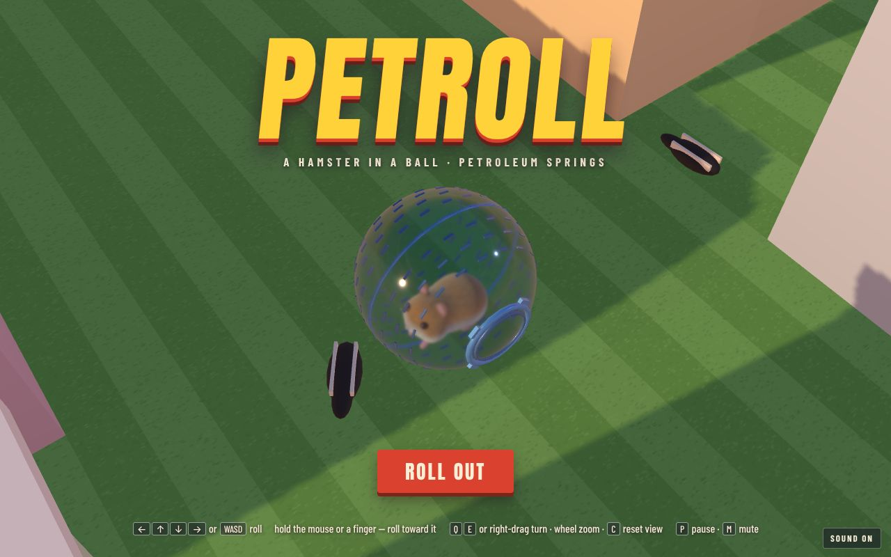
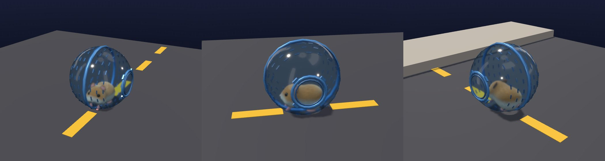
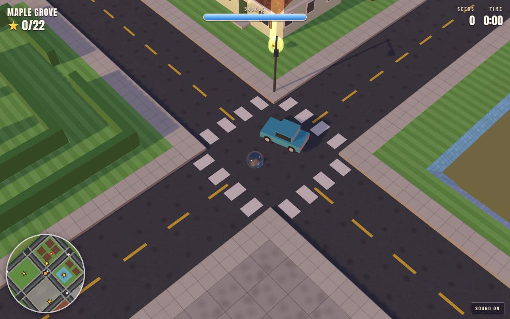
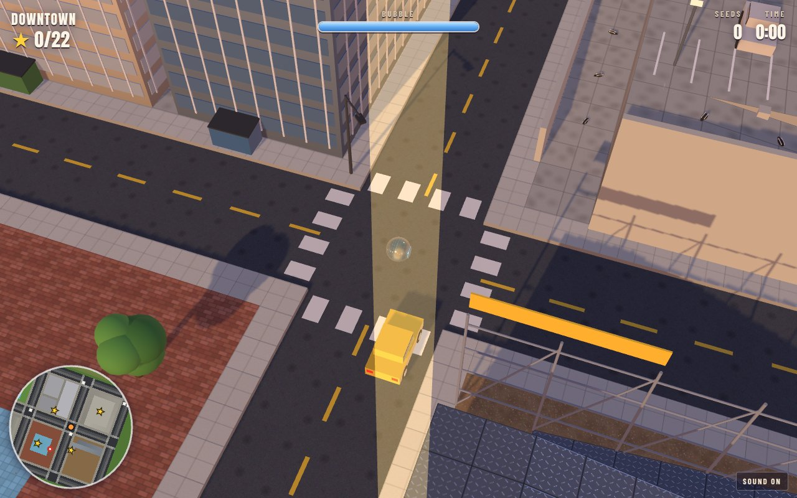
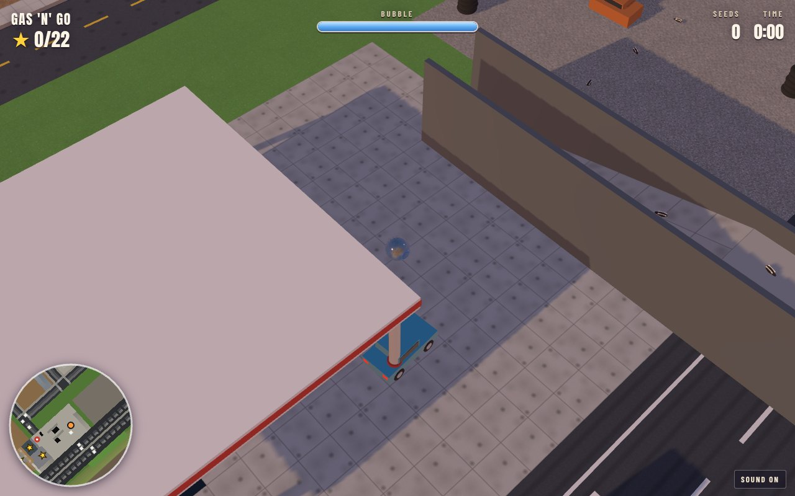
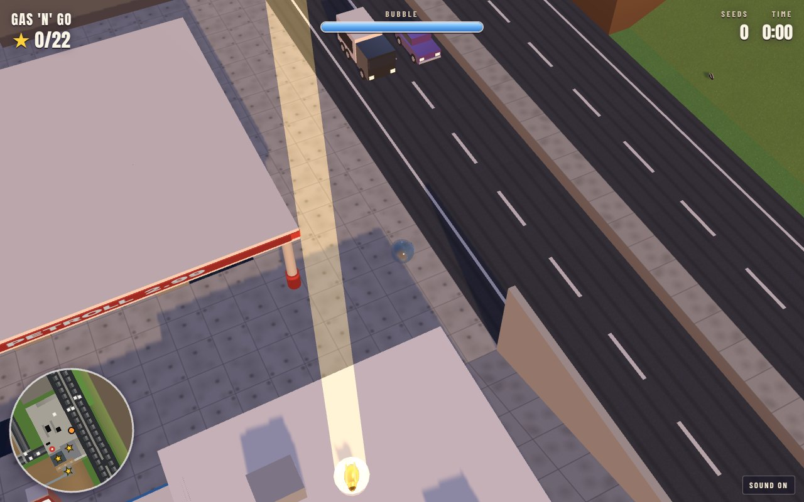
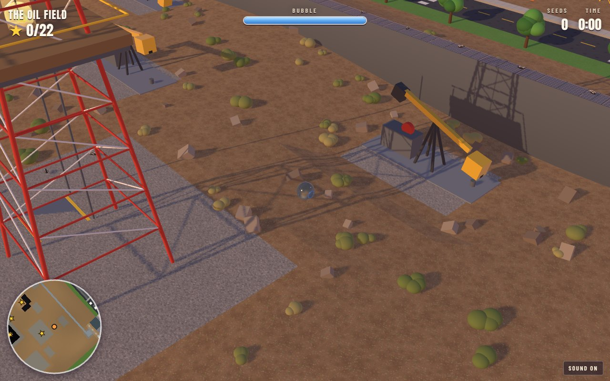
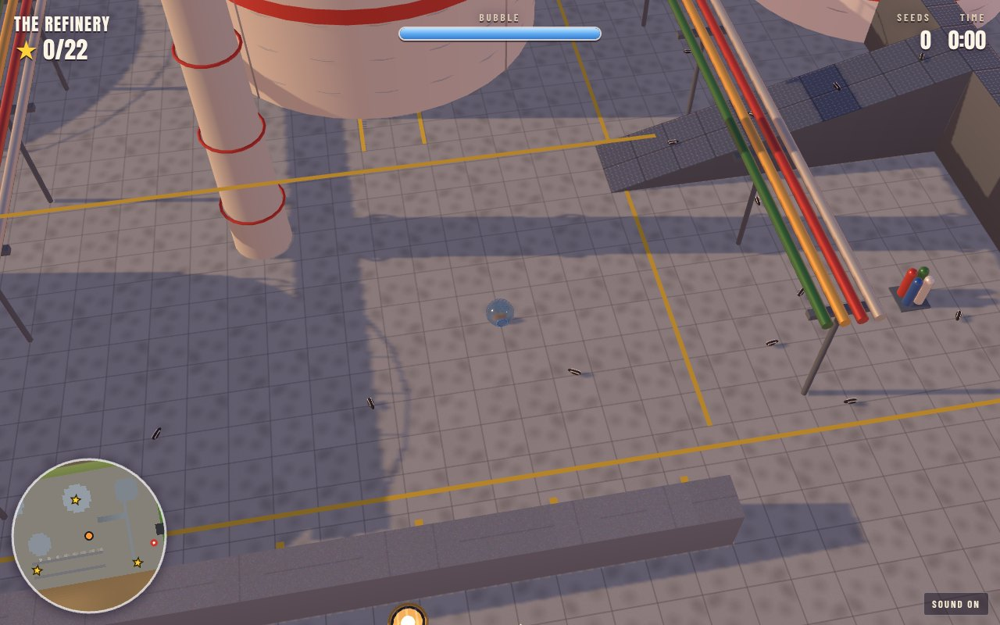

# Petroll

A hamster in a plastic run-about ball, loose in an oil town. There are no
levels: Petroleum Springs is one open map, all of it there from the start,
and the hamster can roll anywhere it can get to. It has suburbs, downtown
traffic, a gas station, the interstate, an oil field with its pumpjacks
nodding, and a refinery where the gas flares up out of the floor.
Somewhere in all of it are **22 golden sunflower seeds**.

It is built the way [Madness](https://github.com/h1ddenpr0cess20/madness) is
built, on the same engine: the renderer, the ball physics, the camera that
turns round the ball, and the ball itself made of two parts. Madness's
marble is a glass shell that rolls with a spark inside it. Petroll's ball
is a plastic shell that rolls with a hamster inside it. The hamster doesn't
roll: it stays on its feet, turns to face where it's going, and runs. It's
sculpted with the SDF sculptor from the
[Rock 'n' Roller](https://github.com/h1ddenpr0cess20/rocknroller-iii) games
(`src/sculpt/`, from [Metroll](https://github.com/h1ddenpr0cess20/metroll)).





## Run

```sh
git clone https://github.com/h1ddenpr0cess20/petroll
cd petroll
npm install
npm run dev               # → http://localhost:5173
```

No server and no keys: it's a static page. `npm run build` puts it in `dist/`,
which runs from any folder or path. WebGPU where the browser has it, WebGL 2
where it doesn't (`?renderer=webgl` pins it). Node 22.12 or later.

## Play

| | |
|---|---|
| <kbd>←</kbd><kbd>↑</kbd><kbd>↓</kbd><kbd>→</kbd> or <kbd>WASD</kbd> | Roll. Up always rolls up the screen, however the view is turned. |
| Hold the mouse or a finger | Roll toward the pointer. The further it is from the ball, the harder the push. |
| <kbd>Q</kbd> <kbd>E</kbd>, or drag with the right mouse button | Turn the view round the ball. Dragging up and down tilts it. |
| Mouse wheel, or <kbd>+</kbd> <kbd>−</kbd> | Zoom. |
| Two fingers | Pinch to zoom, twist to turn, drag up or down to tilt. |
| <kbd>C</kbd> | Put the view back. |
| Gamepad | Left stick or d-pad rolls; right stick turns and tilts; shoulder buttons zoom; <kbd>A</kbd> starts, <kbd>Start</kbd> pauses. |
| <kbd>P</kbd> / <kbd>Esc</kbd> | Pause. |
| <kbd>M</kbd> | Sound on or off. |

The map in the corner turns with the view, so up on it is up the screen. It
shows the traffic, the air pumps, and the golden seeds still to find in each
part of town you've been to.

### The bubble

The ball starts at 100. Hard landings, cars, rolling oil drums and the gas
flares take it down; at nothing it **pops**, and the hamster is back at the
last **air pump** it rolled over. Rolling over an air pump puts the bubble
back to 100 and makes it the place you come back to. A pumpjack's head
coming down on the ball pops it outright. **Tar** swallows it, and it's put
back on the last firm ground it crossed.

Sunflower seeds lie about in lines for eating. The golden ones are what it's
all about. What you've found, the last pump and the time so far are kept in
the browser (`petroll.v1`), with your best time for all 22, and the game
plays the same with storage blocked.

## Petroleum Springs

| | |
|---|---|
|  | **Maple Grove**: the suburbs, and home. Mown lawns, a drained pool to roll round, a hedge maze, a skate park with a quarter pipe you need a run-up for. |
|  | **Downtown**: office towers and the alley behind them, a parking garage to spiral up to the roof, the plaza and its fountain, a building site with switchback scaffolding. Two rings of traffic round the town, one each way, and two more round the middle; cars brake and honk for a hamster in front of them, and shove one beside them. |
|  | **The Gas 'n' Go**: pumps, oil spilt on the forecourt (no grip at all), a car wash that's wet all through, a loading ramp up onto the shop's roof, a junkyard, and a footbridge over the interstate to the billboard on the hill. The canopy fades while you're under it. |
|  | **The Interstate**: trucks, tankers and cars in both directions, out of a tunnel at one end and into one at the other. Nobody brakes. A barrier down the middle, with a gap in it here and there. |
|  | **The Oil Field**: rolling dirt and scrub, pumpjacks nodding on their pads, a pipeline a tile wide to roll along the top of, a derrick with a lift up to the platform, a tar pit with an island in it and a plank out to it, Slick Hill with oil all down one side, and a barrel yard where the drums come after you. |
|  | **The Refinery**: tanks (the tall one has a lift), a ramp up to a catwalk, pipe racks overhead, a flare stack, and flare alley, where the gas comes up out of the floor in a wave you have to ride the gap behind. |

It is always early evening in Petroleum Springs. The sun is low, the shadows
are long, the sky is peach going to violet over hills with derricks on them,
and the plastic, the paint and the puddles all reflect the same sky.

## How it's made

| | |
|---|---|
| `src/vendor/gfx/` | Alan's renderer, as in Madness, unchanged: WebGPU or WebGL 2, physically based shading, transmission, shadows. |
| `src/hamster.js` | The ball (thin tinted plastic, the seam, the twist-off door with its tabs, the air slits) and the hamster, sculpted, baked and running. |
| `src/sculpt/` | Metroll's SDF sculptor (`sdf.js`, `skins.js`), and `bake.js` to make a mesh of a sculpt. |
| `src/map.js` | The map: a grid of tiles, each with four corner heights and a surface, and on top of them road paint, props, solid boxes, decks, roads for the traffic, the hazards and the pickups. It builds the meshes and the collision triangles. |
| `src/town.js` | Petroleum Springs, district by district. |
| `src/surfaces.js`, `src/textures.js` | What the ground is made of, how it grips and drags, and how each surface is painted. |
| `src/props.js`, `src/kit.js` | Everything standing on the map, built from plain shapes and merged into a few meshes. |
| `src/traffic.js` | The cars, round their loops with the corners rounded off, waiting behind each other at junctions and braking for the hamster. |
| `src/hazards.js` | Pumpjacks, gas flares, lifts and oil drums. |
| `src/physics.js` | Madness's sphere physics, with grip and drag per surface and still boxes bucketed. |
| `src/run.js` | The world as it runs, with nothing drawn: the rules for the bubble, the pickups, the pumps. The game draws it; the tests drive it. |
| `src/game.js`, `src/hud.js`, `src/audio.js` | The game, the screen round it (the map in the corner turns with the view), and every sound, synthesised. |

| Script | |
|---|---|
| `npm run dev` | Vite dev server (and `/preview.html`, a turntable for the ball and the hamster: `?tint=f07ab4`, `?speed=4`) |
| `npm run build` | Bundles to `dist/` |
| `npm test` | `node:test`: the physics, the map builder, the town, the traffic, the hazards, the rules, the hamster, and an autopilot that has to find all 22 golden seeds in one go without the bubble popping |
| `npm run lint` | ESLint |

The autopilot (`test/helpers/autopilot.js`) finds its own way across town
(`test/helpers/plan.js`, A* over the tiles) and follows set waypoints where
it has to: up the quarter pipe flat out, off the footbridge onto the
barrier, across the interstate in a gap in the traffic, along the pipeline,
under a pumpjack between nods, along the plank, up and down the lifts, and
down flare alley behind the wave.

In the browser console, `petroll.debug.teleport(x, z)` puts the hamster
anywhere on the map.
